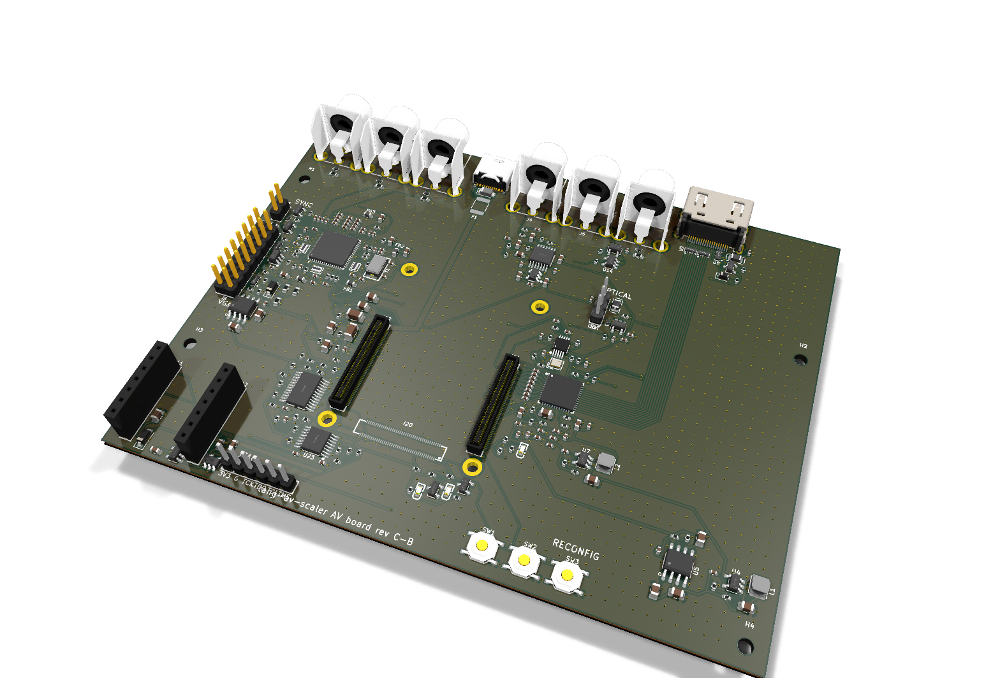
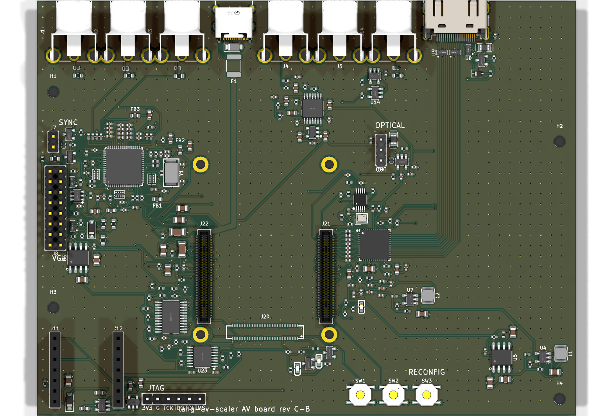
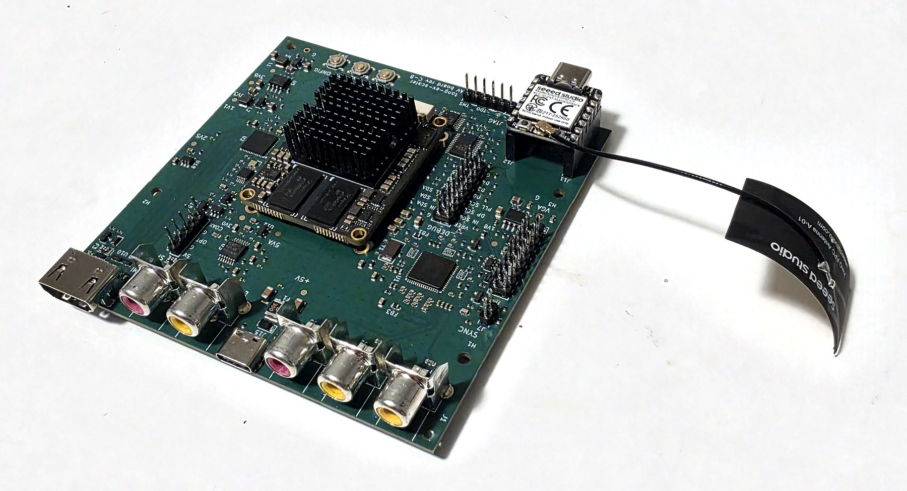
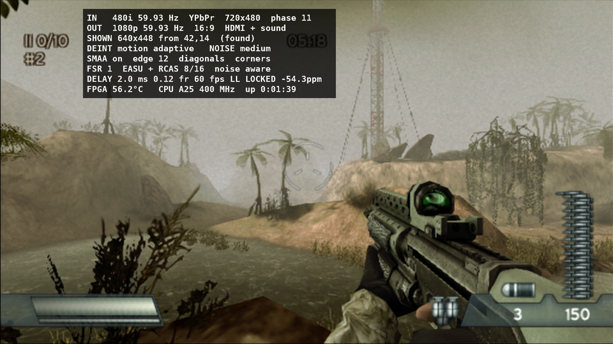
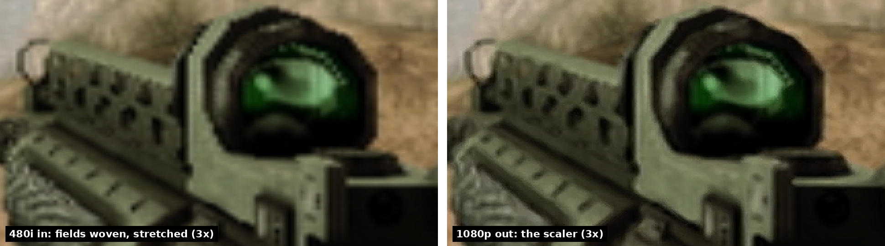

# tang-av-scaler

An FPGA video scaler for the sixth generation of game consoles (PlayStation 2, Xbox, GameCube):
480i component video and stereo sound in, 1080p60 HDMI out, about 2 ms behind the console. A Sipeed
Tang Mega 138K SOM (Gowin GW5AST-138) on a carrier board of its own, with a Seeed XIAO ESP32-C5 for
Wi-Fi. The board, the FPGA design, the software for the FPGA's CPU and the ESP32's firmware are all
here.

```
console: component video (YPbPr, 480i) + stereo audio
  -> ADV7181D decoder, PCM1808 audio converter
  -> GW5AST-138 FPGA
       fields into DDR3 -> motion adaptive deinterlace + noise reduction -> SMAA
       -> FSR 1 upscale (EASU) -> FSR 1 sharpen (RCAS) -> on-screen text -> HDMI coding
       its hard RISC-V CPU: bring-up, settings, frame lock, on-screen text
  -> the FPGA's transceivers -> SN65DP159 -> HDMI 1080p60 with sound
  XIAO ESP32-C5: Wi-Fi, web page, updates, JTAG; talks to the CPU over SPI
```

Status (2026-11-12): the board (rev C-B) is built and runs a console's picture and sound to a
display and a capture device. The table below is what it does now, on the board. The console it
has been run with is a PlayStation 2; an Xbox or a GameCube with its component cable puts out the
same signal (480i, YPbPr, 59.94 Hz) and has not been tried yet.

<p>


</p>



The board, rev C-B ([hardware/av-board/](hardware/av-board/README.md)), as designed (rendered, and from above) and as built:
the SOM under its heat sink, the XIAO and its antenna at the right; along the back edge the HDMI
output, the two audio jacks, power (USB-C) and the three component video jacks.



A frame as it leaves for the display, the on-screen display on (read back from the FPGA: no camera,
no capture device).

## What it does

| | |
|---|---|
| Input | 480i component (YPbPr) through an ADV7181D, sampled line-locked at 13.5 MHz; stereo analogue audio through a PCM1808. The decoder's sampling phase can be set, or tuned to the console's pixels (every phase tried on a still picture, the sharpest kept). |
| Deinterlacing | Motion adaptive from the last four fields, kept in the SOM's DDR3: a field's lines as they are, the lines between from the field before where nothing moves and from their neighbours where something does. Bob and weave can be chosen instead. |
| Noise | Where the picture is still, each sample is averaged with the same one a frame earlier (off, or three strengths). |
| Anti-aliasing | SMAA 1x on the 480-line picture: luma edges, the orthogonal and the diagonal patterns, corners kept. A view that paints what it finds (edges, blends) in the picture's place, for tuning. |
| Scaling | FSR 1's edge adaptive upsampling (EASU) to 1440 x 1080 (4:3) or 1920 x 1080 (16:9, for a game's widescreen mode). Any part of the source can be shown: the black border round a game's picture is measured and left out, so the picture fills the screen (or the part is set by hand). |
| Sharpening | FSR 1's RCAS on luma, in 16 steps, with its noise term (less where a pixel is noise rather than detail). |
| Timing | The output's frames are kept in step with the input's fields (the CPU trims the clock generator: within 10 us, no field shown twice or left out). A frame is made from the field that is still coming in: about 2 ms from a line captured to it sent (16.8 ms with whole fields). |
| Output | 1080p60 (59.94 Hz) HDMI from the FPGA's own transceivers; the console's sound as HDMI audio (two channels of L-PCM at 48 kHz, its clock from the PLL the pixel clock comes from); AVI and audio InfoFrames. Runs a display, a capture device and an AV receiver (picture and sound). |
| On screen | An on-screen display: what comes in and goes out, what is done to the picture, the delay, the lock, the FPGA's temperature. |
| Control | A web page on the XIAO: every setting (applied as it is changed, kept across power cycles), status, a screen capture of the output read back from the FPGA, firmware update over Wi-Fi. |

## What it looks like

Two frozen frames, each in and out: Killzone (PS2, its widescreen mode) and Tales of the Abyss
(PS2, 4:3). "The plain way" is the
two 480i fields as the console sent them, woven into a frame and stretched to 1080p (bilinear),
which is about what a simple scaler or a display does. "The scaler" is its 1080p output (motion
adaptive deinterlacing, noise reduction medium, SMAA with diagonals and corners at edge threshold
12, FSR 1 with sharpening 8/16). Nothing went through a camera or a capture device: the fields are
read out of the FPGA's memory and the output is read back from its last stage, pixel for pixel
(`gateware/tools/still.py`).



**[Drag to compare](https://bryfur.github.io/tang-av-scaler/compare/)**: both frames on a page with a
line to drag between the plain picture and the scaler's, at any size up to four screen pixels a
pixel (`docs/compare/index.html`).

The pictures themselves, in [`docs/compare/`](docs/compare/):

- Whole frames, 1920 x 1080. Killzone: [the plain way](docs/compare/game-plain.png),
  [the scaler](docs/compare/game-scaler.png), [a half of each](docs/compare/game-split.png).
  Tales of the Abyss: [the plain way](docs/compare/abyss-plain.png),
  [the scaler](docs/compare/abyss-scaler.png), [a half of each](docs/compare/abyss-split.png).
- The frames as they came, the fields woven and nothing else (720 x 480):
  [Killzone](docs/compare/game-480i.png), [Tales of the Abyss](docs/compare/abyss-480i.png).
- Parts of Killzone side by side, three times the size: [the tower and its guy wires](docs/compare/tower.png),
  [palms](docs/compare/palms.png), [hanging foliage](docs/compare/foliage.png),
  [HUD text](docs/compare/hud-text.png), [the ammunition counter](docs/compare/ammo.png).

## How it is put together

- **The picture's path is logic** (`gateware/rtl/`): every pixel, at 148.5 MHz out. Each block has a
  model in Python (`gateware/sim/`) and the whole path is simulated against them pixel for pixel:
  the deinterlacer, SMAA, the scaler and the sharpening give exactly the models' pictures.
- **Everything else runs on the FPGA's hard CPU** (an Andes A25 RISC-V in the GW5AST, `gateware/sw/`,
  no operating system): it brings the board's chips up, holds the settings, finds the picture's
  border, tunes the sampling phase, keeps the output in step with the input, writes the on-screen
  text. A new program is loaded in a second, with no new bitstream.
- **The XIAO ESP32-C5** (`firmware/xiao-wifi/`) is the way in: Wi-Fi, the web page, updates, and
  JTAG to load bitstreams. It talks to the CPU over SPI in small messages, keeps the settings for
  when the power is off, and carries the CPU's program.

The design uses 16 % of the FPGA's logic, 75 % of its block RAM and 15 % of its multipliers.

## Measured on the board

| | |
|---|---|
| Delay | 2.0 ms at the top of the picture (some 2.5 ms at the bottom, by the two scan rates) with the picture made from the field coming in; 16.8 ms with whole fields. From the FPGA's own timing of a frame's start against the field; not yet measured from outside, and a display adds its own. |
| Frame lock | within 10 us of its mark, the clock trimmed by some -57 ppm (this console against this board); in step some 20 s after starting 5 ms off |
| Noise | the spread in a frozen frame's flat areas: 2.32 as it comes, 1.98 with the noise reduction; sharpened fully 3.94, with the sharpening's noise term 3.12, with both 2.61 |
| Sampling phase | 4.5 % between the sharpest and the least sharp phase on Killzone (its picture is soft to begin with) |
| Screen capture | 480 x 270 in 2 s, 960 x 540 in 6 s over the web page |

## What is not done

- Consoles other than the PlayStation 2 have not been tried. The Xbox and the GameCube put out the
  same 480i over their component cables; the Dreamcast has no component output (its VGA and RGB
  would come in at the board's inputs that are not used yet).
- Inputs other than 480i: 480p, 576i, 720p and 1080i need the decoder's settings and the capture's
  timing for each.
- 4K output: a 2160p30 test picture is clean on a display; at 2160p60 the link runs and the display
  sees scrambling but shows nothing; the scaler's own path ends at 1080p.
- The board's other inputs (S/PDIF, VGA, RGB with SCART sync) are wired but not used.
- Without the XIAO the CPU starts with its built-in settings: it has no storage of its own.
- At power-on the FPGA loads its image twice, some 20 s more before there is a picture: configured
  before the clock generator runs, one transceiver lane's clock comes up wrong and the lanes'
  resets do not clear it; the XIAO sees that and has the FPGA load again. The right reset is not
  found yet.
- A bitstream into the FPGA's SRAM over Wi-Fi (`avx.py load`) goes in, and the XIAO then restarts
  with the FPGA left unloaded; over USB it works (`gateware/tools/load.sh`).
- The delay has not been measured through a display with a camera or a light sensor.

## The repository

| Directory | What |
|---|---|
| [`hardware/av-board/`](hardware/av-board/README.md) | The board, rev C-B: generated with KiCad's Python API from `rev-cb/board.py`, every circuit from its part's reference design and reviewed against the data sheets; fab files for JLCPCB. Earlier designs that were not built are in `older/`. |
| [`gateware/`](gateware/README.md) | The FPGA design: `rtl/` the logic, `sw/` the CPU's program, `sim/` the models and testbenches, `gowin/` the build, `tools/` the host's scripts (registers, loading, stills), `docs/` notes. |
| [`firmware/xiao-wifi/`](firmware/xiao-wifi/README.md) | The XIAO ESP32-C5's firmware: Wi-Fi, the web page, updates, a JTAG server, the link to the FPGA's CPU. (`firmware/xiao/` is an earlier USB-only bridge for an ESP32-S3.) |

Building and loading: [gateware/README.md](gateware/README.md) (the bitstream and the CPU's
program: Gowin's tools, a RISC-V GCC) and [firmware/xiao-wifi/README.md](firmware/xiao-wifi/README.md)
(ESP-IDF). With the bitstream in the SOM's flash and the firmware in the XIAO, the board needs
power, a console and a display.

## Reference documents

`hardware/av-board/refs/` (not in git: the vendors' copyright) holds the data sheets and user
guides the circuits follow; [hardware/av-board/README.md](hardware/av-board/README.md) lists which
and where each came from. The scaler's algorithms: SMAA (Jimenez et al.) and AMD's FidelityFX Super
Resolution 1 (EASU and RCAS, MIT licence), both written again for this hardware
(`gateware/sim/smaa.py`, `gateware/sim/fsr.py` say how they differ).
