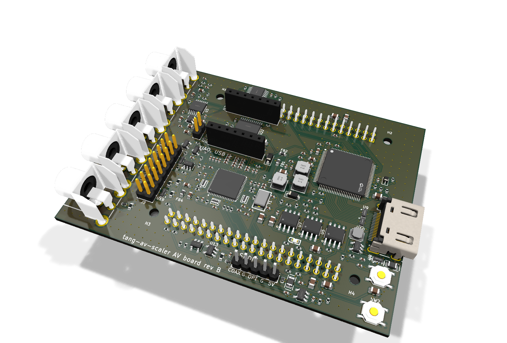

# tang-av-scaler

A PS2-class console's component video, cleaned up on a Sipeed Tang Console 138K: deinterlaced,
anti-aliased with SMAA, scaled, and sent out as 1080p60 HDMI with the console's sound.

```
PS2 component (YPbPr) + stereo audio
  -> AV board: ADV7181D (video ADC/decoder; rev A: ADV7842)         on the Console's J10 header
               PCM1808 (audio ADC)                                on the Console's J9 header
  -> GW5AST-138 FPGA: capture -> deinterlace -> SMAA 1x -> scale
  -> AV board: ADV7511 (HDMI transmitter)                           on the Console's J9 header
  -> HDMI 1080p60 with audio
```

| Directory | What |
|---|---|
| `hardware/av-board/` | The AV board: one board on the Console's two 2x20 headers (J9, J10), the Console's size, over the 138K SOM. Generated with KiCad's Python API; every circuit taken from the parts' reference designs. Revisions in `rev-a/`, `rev-b/` (hats on the Console), `rev-ca/`, `rev-cb/` (the SOM on its own carrier, shared parts in `rev-c/`), their shared generators in `kit/`. |

Status: rev A (ADV7842, six layers) is routed and ready to order but costs about $400 at
JLCPCB. Rev B (ADV7181D, four layers, a hat on the Console) and rev C-A / C-B (the SOM on a carrier
of its own: 1080p60 through an ADV7511, or 4K60 from the FPGA's transceivers) are reviewed against
every data sheet; rev B and C-B are routed, DRC clean, with fab files; C-A is being routed. Nothing
has been built or ordered.

## The boards

Rendered from the generated KiCad boards (`hardware/av-board/kit/render.py`); none built yet.

| Rev B: a hat on the Tang Console | Rev C-B: the SOM on its own carrier, 4K60 HDMI |
|---|---|
|  |  |

Every revision, top and 3D views: [hardware/av-board/README.md](hardware/av-board/README.md#pictures).

## The host board

Sipeed Tang Console with the Tang Mega 138K SOM (GW5AST-LV138PG484AC1/I0, revision C), board
revision 32001C. Its two 2x20 headers (J9 "SDRAM0", J10 "SDRAM1") carry 38 FPGA I/O each,
+5 V on pin 11 and GND on pin 12, no 3.3 V. Sipeed's schematic, interactive BOM and 3D models:
`https://dl.sipeed.com/shareURL/TANG/Console`.

## Reference documents

`hardware/av-board/refs/` (not in git: the vendors' copyright) holds the datasheets and user
guides the circuits follow; the board's README lists which and where each came from.
