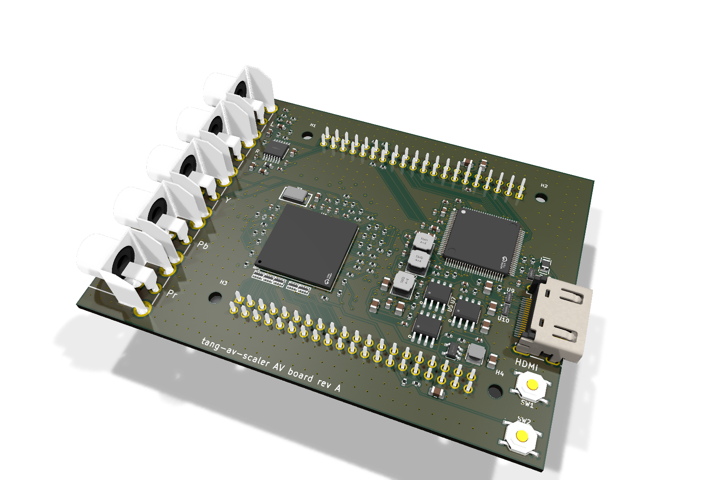
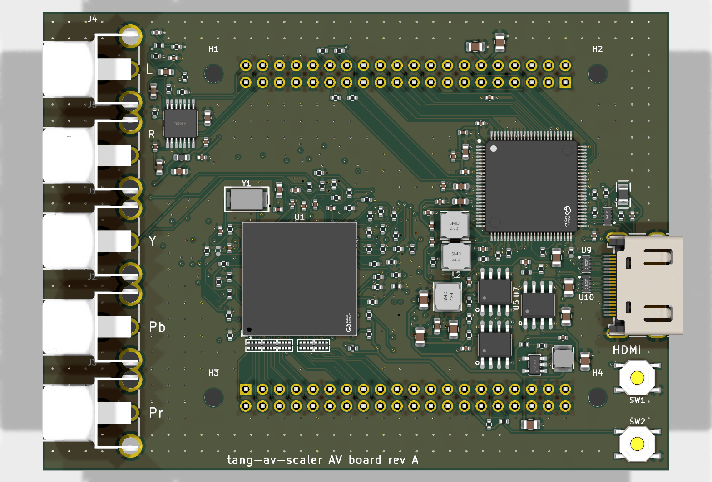
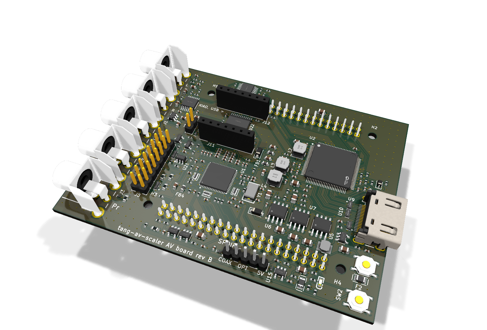
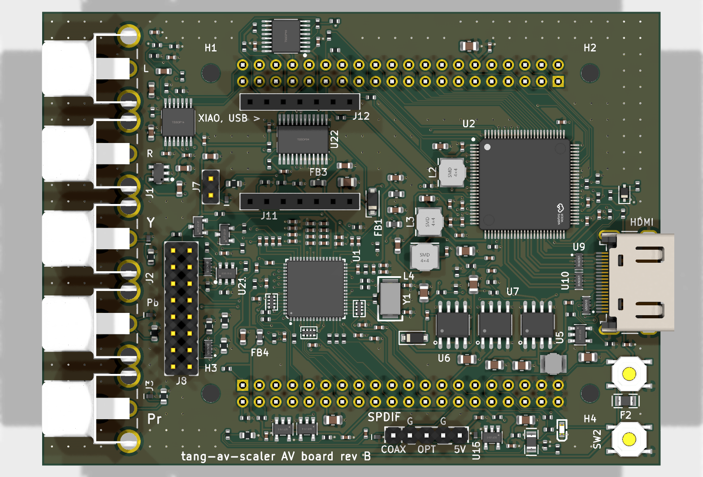
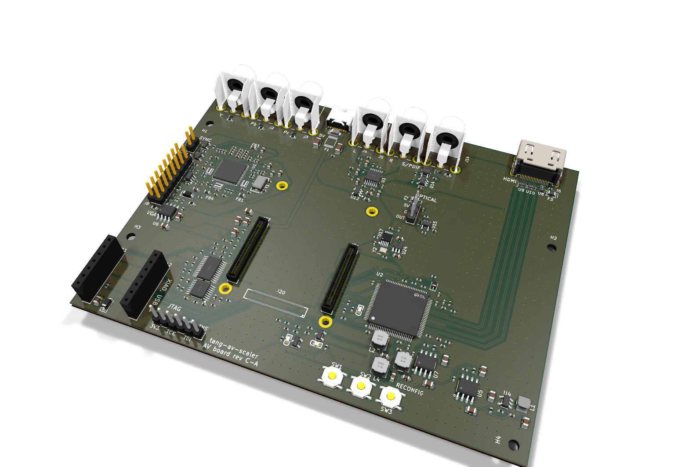
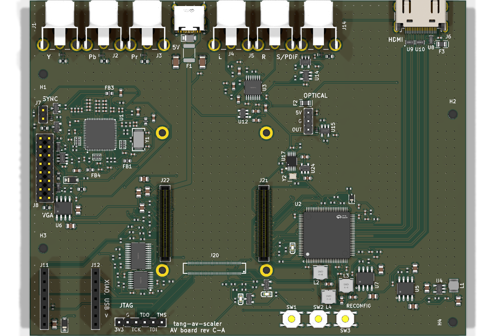

# The AV board's other revisions

Designs made on the way to rev C-B ([../rev-cb](../rev-cb), the one that is built and runs the
scaler). None of these was built. They are kept because rev C-B's circuits and their review began
here: the ADV7181D front end, the audio converter, the supplies and the XIAO's sockets are rev B's,
from the same code (`../kit/circuits.py`), described in [rev-b/design.md](rev-b/design.md) and
reviewed in [rev-b/review.md](rev-b/review.md); what the data sheets and reference designs say
about the ADV7842 and the ADV7511 is in [rev-a/reference-notes.md](rev-a/reference-notes.md).

| Revision | Video in | Layers | What it was |
|---|---|---|---|
| [rev-a](rev-a/) | ADV7842 (256-ball BGA) | 6 | Routed, DRC clean, fab files made (not ordered): about $400 at JLCPCB, the BGA and six layers the cost |
| [rev-b](rev-b/) | ADV7181D (64-lead LFCSP) | 4 | Reviewed against every data sheet (twice), routed, DRC clean, fab files made (not ordered): the cheaper decoder, no BGA, four layers (two ground planes), 230 parts, SMT on the top only; a variant BOM leaves the RCA jacks for hand soldering; HDMI CEC, a SCART sync input, an S/PDIF input (coax or an optical module; Dolby Digital/DTS passed to HDMI), a VGA header (RGBHV with DDC), a status LED and sockets for a Seeed XIAO (ESP32: Wi-Fi/Bluetooth) |
| [rev-ca](rev-ca/) | ADV7181D | 4 | The SOM on its own carrier (../rev-c/design.md), HDMI from an ADV7511 at up to 1080p60 fed 24-bit RGB; USB-C power, the XIAO as the FPGA's programmer (JTAG) and console, an orange RCA for S/PDIF coax, a clock generator for frame-locked output, the VGA header; 280 parts. Rev B's circuits from the same code (../kit/circuits.py); the new parts reviewed against their data sheets (../rev-c/review.md). Routed, DRC clean, fab files made (not ordered) |

Rev A and B are hats on Sipeed's Tang Console (the 138K SOM's own board); rev C-A is rev C-B with
an ADV7511 HDMI transmitter in the SN65DP159's place (1080p60 at most), on the same shared files
(`../rev-c/`).

The generators still work from here: `python3 kit/gen_sch.py rev-b`, `python3 older/rev-b/gen_pcb.py`
and so on, from `hardware/av-board/` (`kit/rev.py` finds a revision in `older/` by its name).

## Pictures

| | 3D | Top |
|---|---|---|
| Rev A (ADV7842, 6 layers) |  |  |
| Rev B (ADV7181D, a hat on the Console) |  |  |
| Rev C-A (the SOM's carrier, ADV7511, 1080p60) |  |  |

## The host's headers (Sipeed's schematic Tang_138K_Console_V32001C, sheet FPGA_EXT_CONN)

J9 ("SDRAM0") and J10 ("SDRAM1"): 2x20, 2.54 mm, SMD male headers, parallel, 49 mm apart (J9 along
the top edge at y = 30 mm, J10 along the bottom at y = 79 mm in Sipeed's PCB coordinates, both
x = 105-153 mm, pin 1 at opposite ends). Each carries 38 FPGA I/O at 3.3 V; pin 11 is +5 V,
pin 12 GND; no 3.3 V. Pins 29/30 (EXIO0/1) reach the DM0/DM1 balls through 0 R links.

- J9: all FPGA bank 2. Clock-capable balls on it: D19/E19 (SGCLK_0), C19/C18 (MGCLK_0),
  C17/D17 (MGCLK_1), B18/B17 (SGCLK_1).
- J10: all FPGA bank 4. Clock-capable: V20/U20 (SGCLK_5), Y19/Y18 (MGCLK_4); P19 is SSPI_CLK.

The full pin -> ball map is taken from the schematic's SOM connector sheets (pages 4-6).
