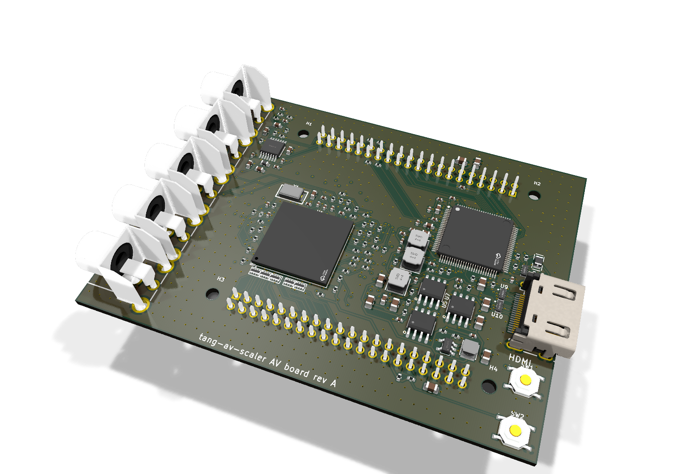
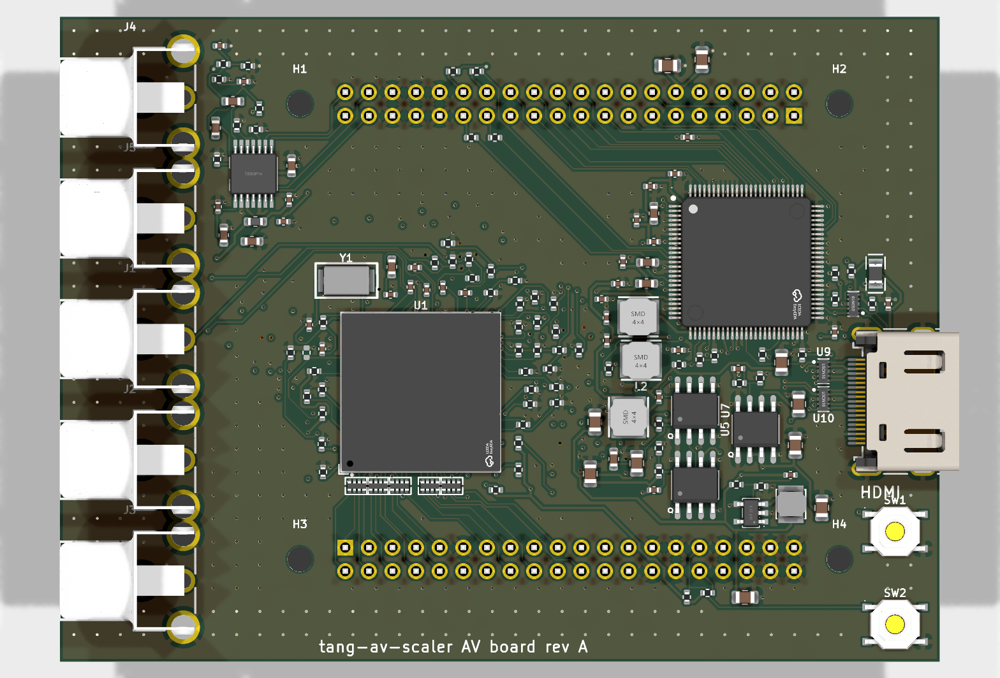

# AV board rev A

The ADV7842 board: component video into an ADV7842 (256-ball BGA, 1.0 mm pitch), stereo audio
into a PCM1808, HDMI out of an ADV7511. Six layers.

Status: routed (Freerouting, mazeroute.py, the TMDS pairs refined on DeepPCB), DRC clean, fab
files made; not ordered. JLCPCB quoted about $400 for it, most of that the BGA (and the six
layers its escape needs: four did not route). Rev B replaces the ADV7842 with the ADV7181D.

- [design.md](design.md): the electrical design, connection by connection, with its sources
- [reference-notes.md](reference-notes.md): what ADI's and TI's reference designs say
- `board.py`, `gen_pcb.py`: the sources; made as in [../README.md](../README.md)

## Ordering at JLCPCB

`fab/av-board-a-gerbers.zip` for the board, `fab/av-board-a-bom.csv` and `fab/av-board-a-cpl.csv`
for assembly. Settings the files do not carry:

- 6 layers, 1.6 mm, stack-up **JLC06161H-7628B** (the TMDS geometry assumes its 0.218 mm 7628
  prepreg under the outer layers); impedance control on: the TMDS pairs are 0.2 mm with 0.15 mm
  gap on the outer layers, about 100 R differential. Confirm in JLCPCB's impedance calculator.
- Via 0.3 mm drill / 0.5 mm pad, minimum track and space 0.127 mm.
- Assembly on both sides (83 of 229 parts are on the bottom), including the through-hole parts
  (J9/J10 sockets on the bottom, RCA jacks, HDMI). The ADV7842 is a 1.0 mm-pitch BGA.
- Check every part's rotation in JLCPCB's placement preview: its library sometimes turns a part
  90 or 180 degrees from KiCad's.
- TEST8's pull-down (DNP) is left out of the BOM on purpose (design.md).
