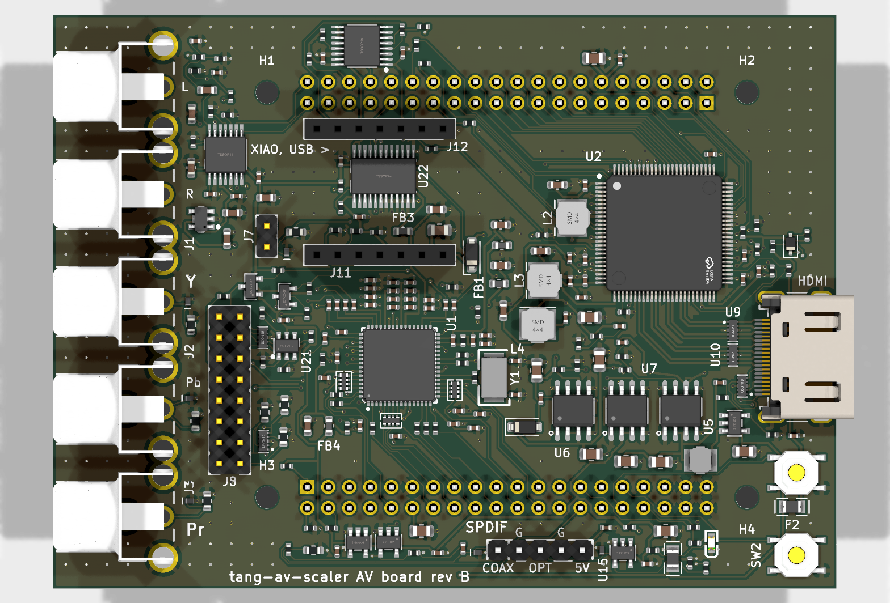

# AV board rev B

Rev A with the ADV7842 (256-ball BGA) replaced by the ADV7181D (64-lead LFCSP): component video
into the ADV7181D, stereo audio into a PCM1808, HDMI out of an ADV7511. Four layers, no BGA.

Status: reviewed against every part's data sheet (review.md), routed, DRC clean, fab files made;
not ordered.

- [design.md](design.md): what changed from rev A, and the ADV7181D's circuit with its sources
- [review.md](review.md): every part checked against its data sheet, with the fixes
- `board.py`, `gen_pcb.py`: the sources; made as in [../README.md](../README.md)

## Ordering at JLCPCB

`fab/av-board-b-gerbers.zip` for the board; for assembly, one of:

| BOM + CPL | Assembled by JLCPCB | By hand |
|---|---|---|
| `fab/av-board-b-bom.csv`, `fab/av-board-b-cpl.csv` | everything (230 parts) | nothing |
| `fab/av-board-b-hand-jacks-bom.csv`, `fab/av-board-b-hand-jacks-cpl.csv` | everything but the RCA jacks (225 parts) | J1-J5: CUI RCJ-014 (yellow) for Y, Pb and L, RCJ-012 (red) for Pr and R, LCSC C4991844 / C4991691, or any RCJ-01x |

Settings the files do not carry:

- 4 layers, 1.6 mm, stack-up **JLC04161H-7628**: F.Cu signal / In1 GND / In2 GND / B.Cu signal
  (the TMDS geometry assumes the 0.21 mm 7628 prepreg under each outer layer). Impedance control
  on: the TMDS pairs are 0.25 mm lines with a 0.25 mm gap on F.Cu, 103 R differential by
  IPC-2141. Confirm in JLCPCB's impedance calculator (outer layer, W 0.25, S 0.25). The voids
  in In1 and In2 under the ESD arrays' TMDS pads are meant (TI SPRAAR7 3.14; review.md's TMDS
  layout row, `kit/hdmi_audit.py rev-b`).
- Vias 0.5/0.3 mm, and four 0.4/0.2 mm ones at the ESD arrays' GND pads (inside JLCPCB's
  0.3/0.15 mm four-layer minimum; check the quote does not add a small-via charge). Minimum track
  and space 0.127 mm.
- Assembly: **top side only**: every SMT part is on the top. Underneath are only the J9/J10
  sockets (through-hole, soldered from the top). Through-hole parts: the two sockets, HDMI's
  shell, and the RCA jacks unless they are left for hand soldering.
- The XIAO itself is not on the BOM: any Seeed XIAO (ESP32-C3, -S3 or -C6) plugs into J11/J12,
  its USB-C towards the HDMI side (silkscreen "XIAO, USB >"). J7 (SCART sync) is a plain 2-pin
  header: SYNC, GND. J13 (S/PDIF) is a 5-pin header: COAX, GND, OPT, GND, 5V (design.md). J8 (VGA) is a 2 x 8 header,
  pin n the DE-15's pin n, for a bracket cable.
- Check every part's rotation in JLCPCB's placement preview, mainly U1 (the ADV7181D: pin 1 at
  the dot, AIN10 at its top left), U2, U3, the regulators and the three resistor arrays RN1-RN3,
  and the RCA jacks' barrels over the edge (the CPL turns the yellow ones 90 degrees for JLCPCB's
  footprint, kit/gen_fab.py JLC_TURN; the red RCJ-012 has no model there and is placed as drawn,
  as the black RCJ-011).
