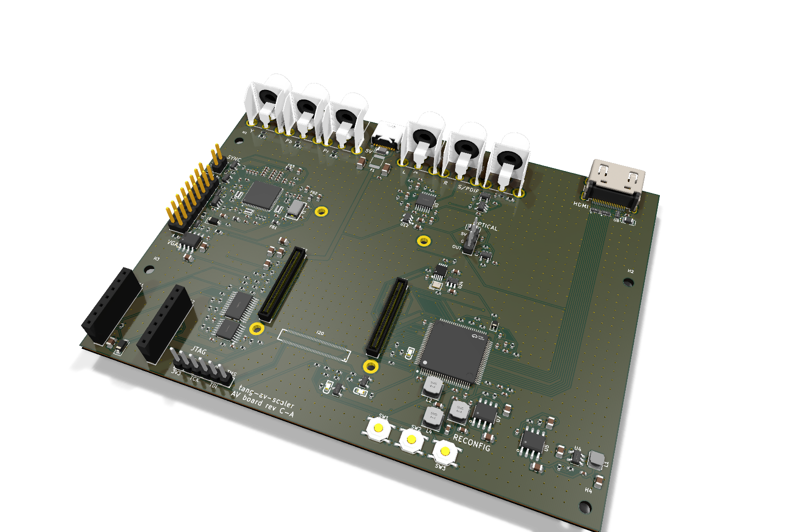
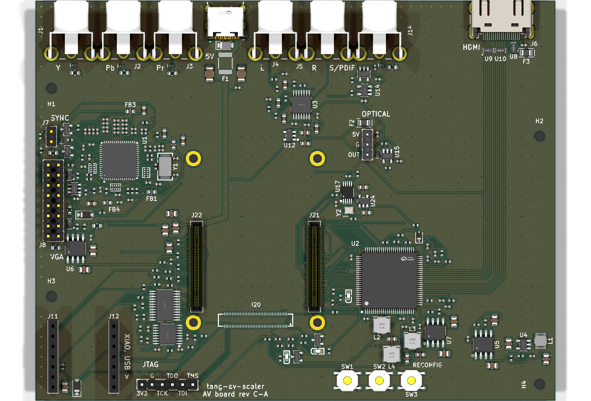

# AV board rev C-A

The Tang Mega 138K SOM on its own carrier, HDMI from an ADV7511 at up to 1080p60 (rev B's, fed
24-bit RGB 4:4:4). Everything else is shared with rev C-B: [../rev-c/design.md](../rev-c/design.md)
describes both.

Status: designed, reviewed against the data sheets ([../rev-c/review.md](../rev-c/review.md) for
the parts rev C adds; rev B's circuits, shared, in [../rev-b/review.md](../rev-b/review.md)), placed
and routed: DRC clean, no unconnected items, fab files made; not ordered.

- `board.py`: the parts and nets (the shared circuit in ../rev-c/carrier.py and ../kit/circuits.py)
- `gen_pcb.py`: the PCB (../rev-c/layout.py, kit/)
- `fpga/av-board-ca.cst`: the FPGA pin assignment, Gowin constraints, generated from the board

## Ordering at JLCPCB

As rev B ([../rev-b/README.md](../rev-b/README.md)): `fab/` holds the Gerbers and the BOM/CPL, and a
`hand-jacks` BOM/CPL leaves the six RCA jacks for hand soldering. Settings the files do not carry:

- 4 layers, 1.6 mm, stack-up **JLC04161H-7628** (F.Cu / In1 GND / In2 GND / B.Cu), impedance
  control on.
- Minimum clearance 0.1 mm (the USB-C receptacle's own GND/VBUS pads; JLCPCB's four-layer minimum
  is 0.09 mm); 0.4/0.2 mm vias at the SOM receptacles' ground pads and the ESD arrays.
- Top-side assembly only. Fitted by hand: the SOM's four M2 x 3 mm spacers and M2 screws, the XIAO
  ESP32-S3 (in its sockets J11/J12, its USB-C towards the board's bottom edge: silkscreen
  "XIAO, USB >" beside J12; a C3 works too, JTAG over Wi-Fi only), and the jacks
  for the `hand-jacks` variant.
- Power from a 5 V / 3 A USB-C supply (the board and SOM draw up to about 2 A; a sink with only
  5.1 k on CC cannot ask a weaker source for less). J16 (JTAG) is for a cable with the XIAO out of
  its sockets.
- Check in JLCPCB's preview: the SOM receptacles J20-J22 on their pads (JLCPCB's footprint numbers
  them as a mirror of ours, so its pin 1 dot shows at the far end of the row: the DF40 has no
  polarity [Hirose DF40 drawings], either way is right; do not turn them), the USB-C (mouth out
  of the back edge), the chips' rotations, the RCA jacks' barrels over the back
  edge (the CPL turns the yellow and orange ones 90 degrees for JLCPCB's footprint, kit/gen_fab.py
  JLC_TURN; the red RCJ-012 has no model there and is placed as drawn, as the black RCJ-011).
