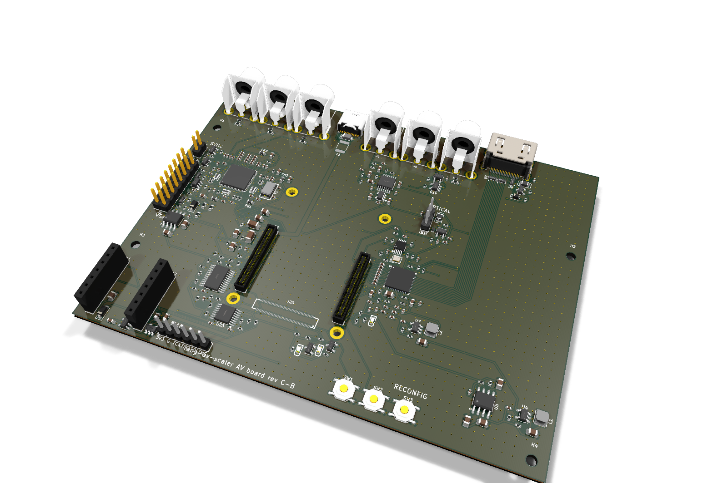
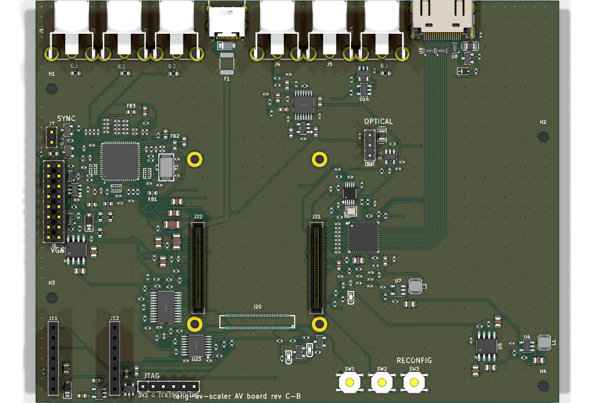

# AV board rev C-B

The Tang Mega 138K SOM on its own carrier, HDMI 2.0 from the FPGA's transceivers through a TI
SN65DP159 retimer, up to 4K60. Everything else is shared with rev C-A:
[../rev-c/design.md](../rev-c/design.md) describes both.

Status: designed, reviewed against the data sheets ([../rev-c/review.md](../rev-c/review.md) for
the parts rev C adds; rev B's circuits, shared, in [../rev-b/review.md](../rev-b/review.md)), placed
and routed; not ordered.

- `board.py`: the parts and nets (the shared circuit in ../rev-c/carrier.py and ../kit/circuits.py)
- `gen_pcb.py`: the PCB (../rev-c/layout.py, kit/)
- `fpga/av-board-cb.cst`: the FPGA pin assignment, Gowin constraints, generated from the board

## Ordering at JLCPCB

As rev B ([../rev-b/README.md](../rev-b/README.md)): `fab/` holds the Gerbers and the BOM/CPL, and a
`hand-jacks` BOM/CPL leaves the six RCA jacks for hand soldering. Settings the files do not carry:

- 4 layers, 1.6 mm, stack-up **JLC04161H-7628** (F.Cu / In1 GND / In2 GND / B.Cu), impedance
  control on.
- The four transceiver TX pairs (J21 to the SN65DP159) and the TMDS pairs: 100 R differential on
  F.Cu over In1 (the TMDS pairs 0.25/0.25 mm, as rev B; the 7 mm TX lanes 0.2 mm lines at the
  SOM connector's 0.4 mm pitch). Confirm in JLCPCB's impedance calculator.

- Minimum clearance 0.1 mm (the USB-C receptacle's own GND/VBUS pads; JLCPCB's four-layer minimum
  is 0.09 mm); 0.4/0.2 mm vias at the SOM receptacles' ground pads and the ESD arrays.
- Top-side assembly only. Fitted by hand: the SOM's four M2 x 3 mm spacers and M2 screws, the XIAO
  ESP32-S3 (in its sockets; a C3 works too, JTAG over Wi-Fi only), and the jacks
  for the `hand-jacks` variant.
- Power from a 5 V / 3 A USB-C supply (the board and SOM draw up to about 2 A; a sink with only
  5.1 k on CC cannot ask a weaker source for less). J16 (JTAG) is for a cable with the XIAO out of
  its sockets.
- Check in JLCPCB's preview: the SOM receptacles J20-J22 (their pad 1 at the Console's), the
  USB-C (mouth out of the back edge), the chips' rotations.
