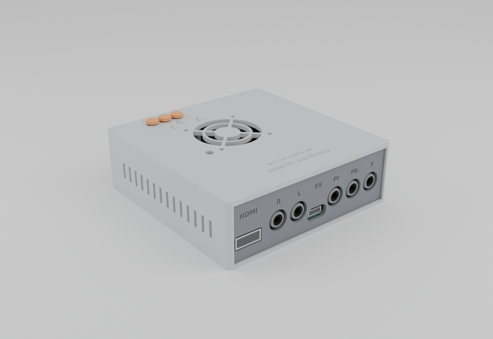
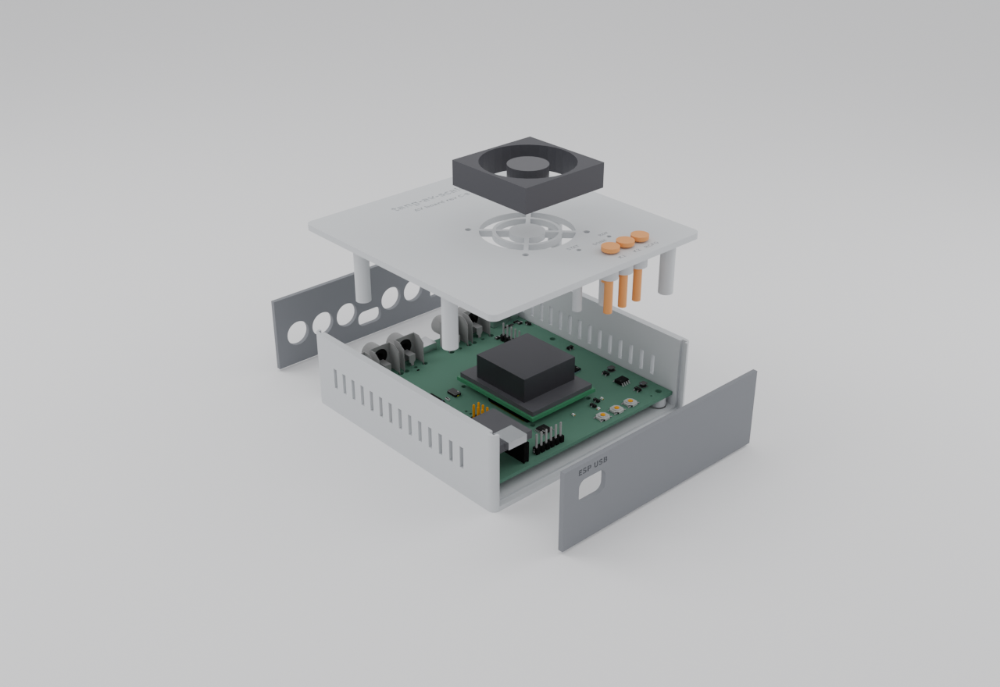
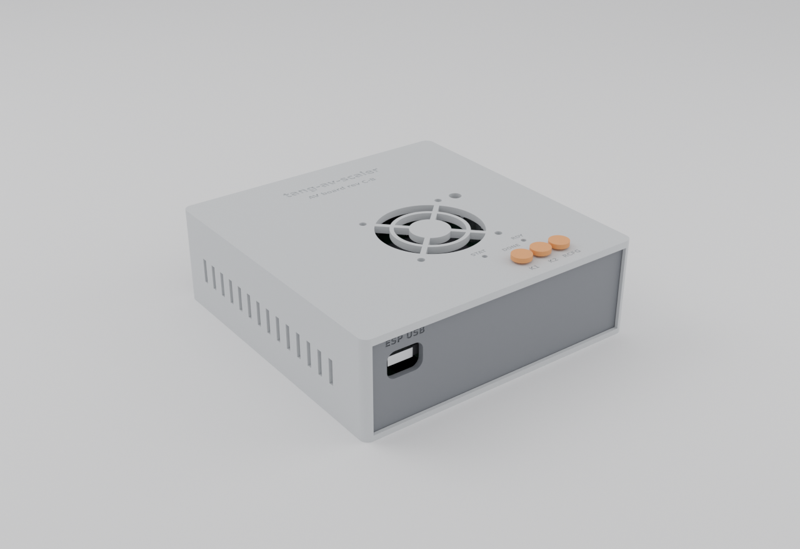
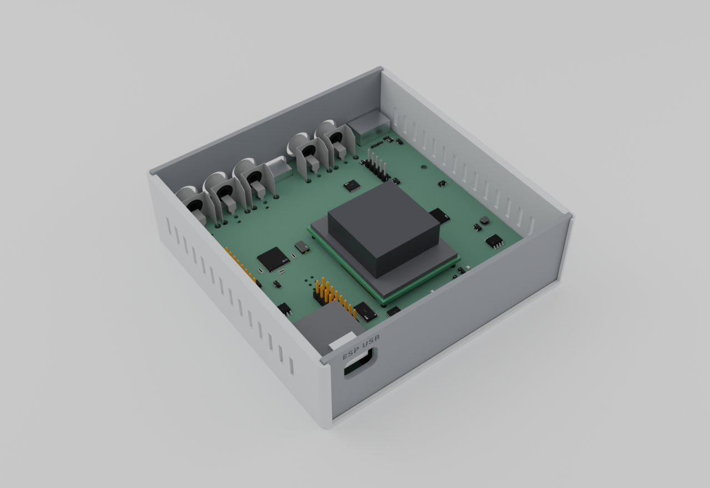

# A case for the AV board (rev C-B)

A 3D-printed case for the scaler: the board, its SOM with heatsink and the XIAO inside; the jacks,
HDMI and USB-C power through the back panel, the XIAO's USB-C through the front, the three
buttons and three LEDs on top, and a mount for a 5 V fan on the lid, over the SOM's heatsink.
107 x 109 x 35 mm (plus the fan).





| Front | Lid off |
|---|---|
|  |  |

It is generated from the board: `case.py` reads the outline, the four mounting holes, the jacks,
buttons and LEDs from `../av-board/rev-cb/av-board-cb.kicad_pcb` and the SOM's place from
`../av-board/rev-c/floor.py`, so a change to the board carries over by running it again.

## Printing

`out/` holds the parts, each already turned the way it prints (no supports anywhere):

| File | Qty | On the bed |
|---|---|---|
| `base.stl` | 1 | floor down |
| `lid.stl` | 1 | top face down (the pillars, tubes and button guides grow up from it) |
| `back.stl` | 1 | outside face down |
| `front.stl` | 1 | outside face down |
| `button.stl` | 3 | head down |

`out/case.step` is the whole case as fitted, for editing elsewhere. PLA or PETG, 0.2 mm layers,
3 walls; the labels are engraved 0.4 mm into the faces on the bed. PETG if the case will sit
somewhere warm: the FPGA's heatsink runs warm and the lid is over it.

## Parts besides the print

- 4 x M2.5 x 16 pan or cheese head screws (the board's holes are M2.5)
- a 5 V fan, 40 x 40 x 10 mm (or 30 / 25 mm: `FAN` in `case.py`; `FAN = 0` gives plain vent
  slots instead), and 4 x M3 x 16 screws: through the fan's corners, they cut their thread in
  bosses under the lid
- optional: 4 x M2.5 heat-set inserts (3.5 mm, 4 mm long): set `INSERT = True` and rebuild;
  without them the screws cut their own thread in the lid's pillars
- 3 x 24 mm of clear 1.75 mm filament, as light pipes over the LEDs
- 4 x 10 mm stick-on rubber feet (recesses in the floor)

## Assembly

1. Hold the back panel against the jacks: the RCA barrels, the USB-C and the HDMI receptacle go
   into its openings. Lower board and panel together into the base: the panel into its grooves,
   the board onto the four standoffs.
2. Slide the front panel down its grooves (it clears the XIAO's USB-C).
3. Put each button into its guide in the lid from the top, its tab along the guide's keyway (to
   the right), push it down and turn it a quarter: the head keeps it from falling in, the tab from
   coming out, so the buttons stay with the lid. Stick the XIAO's antenna to the inside of the
   lid, away from the fan.
4. Put the lid on (the panels go into its grooves), turn the case over holding it shut, and fit
   the four screws from below: each passes the floor, a standoff and the board and threads into a
   lid pillar, so the board is clamped between standoff and pillar.
5. Push a piece of clear filament into each LED tube from the top, flush.
6. The fan sits on the lid over the grille, screwed down through its corners. Its wire goes in
   through the hole beside it and plugs onto J13 pins 4 (GND) and 5 (5 V): the S/PDIF header's
   module supply, behind a 0.2 A resettable fuse, enough for a fan of up to ~150 mA with an
   optical receiver on the same pins. Blowing down onto the heatsink, the air leaves through the
   side slots.

On top, from the left: STAT (the scaler's status LED), DONE and RDY (the FPGA's configuration);
K1, K2 (the scaler's buttons) and RCFG (RECONFIG: reloads the FPGA from flash).

## What was measured and what was not

`check.py` tests the case against the board as built: every part's 3D model from KiCad's export,
plus stand-ins for what KiCad lacks or places wrongly. Last run: no part of the board inside the
case; the tightest spots 0.4 mm (the HDMI shell in its opening), 0.6 mm (an LED tube beside a
transistor), 1.0 mm (an LED tube by the SOM's corner).

Taken from the 3D models: the RCA barrels' axis 6.6 mm above the board and 2.06 mm past its
edge, every header's and socket's height, the switches, the LEDs, the leads under the board.
From the footprints (KiCad's models of these two sit 2-7 mm off their pads): the HDMI
receptacle's mouth 2.1 mm past the edge, the USB-C's 0.6 mm.

Estimates, worth a look on the real board before printing (all are parameters in `case.py`):

- the SOM's heatsink: taken as ~28 x 28 mm, its top ~17 mm above the board; the lid's underside
  is 24 mm above the board (`INNER`), room for it, Dupont housings on the headers and air (and
  why the fan goes on top: a 10 mm fan under the lid would sit on the heatsink)
- the XIAO's USB-C: its centre ~15.3 mm above the board's underside (`XIAO_USB_Z`), reaching
  1-1.5 mm past the board's front edge; the front opening is 13 x 9.4 mm to allow +-1.5 mm
- the HDMI receptacle's shell: 6.1 mm tall on the board (the part's name, H6.1); its opening
  is 16 x 7.4 mm

Openings sized for plugs: RCA 11 mm (an RCA plug's shell passes; its moulding stops at the
panel), USB-C power 12.8 x 7 mm (the USB-C overmould limit is 12.35 x 6.5 mm).

Not brought out: the VGA/RGB and sync headers (J8, J7), the S/PDIF header (J13), the debug
header (J17) and JTAG (J16) stay inside; a TOSLINK receiver for J13 would need a place in a
wall.

## Regenerating

```
~/tools/cad-venv/bin/python case.py      # out/*.stl, case.step (CadQuery 2.8)
~/tools/cad-venv/bin/python check.py     # needs kicad-cli (fpga) for the board's 3D export
blender -b -P render.py -- BOARD.glb     # img/*.png (bryan-ld); BOARD.glb: the export check.py made
                                         # (--glb FILE, else $TMPDIR/av-board-cb-case.glb)
```

`~/tools/cad-venv`: `python3 -m venv --without-pip`, pip from another venv, then
`pip install cadquery trimesh rtree scipy`.
